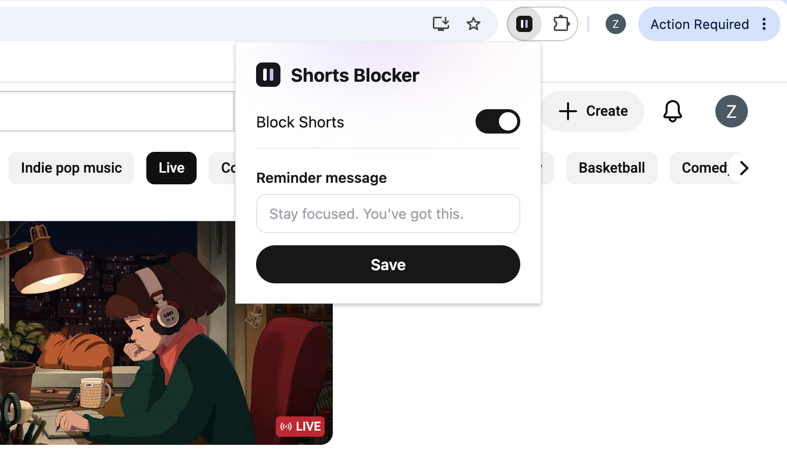
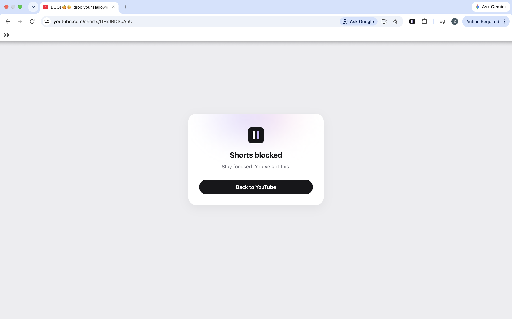

# Shorts Blocker

A small Chrome extension (Manifest V3) that blocks YouTube Shorts pages and shows a reminder message you write yourself. It is built with HTML, CSS and JavaScript, with no frameworks and no npm dependencies.

## Features

- **Shorts blocking**: opening a YouTube Shorts page (`youtube.com/shorts/...`) shows a full-screen blocking screen with a "Back to YouTube" button. Normal videos, search and channel pages are not affected.
- **YouTube navigation support**: YouTube is a single-page app, so clicking a Short from the homepage does not reload the page. The extension listens for YouTube's in-page navigation and the browser's back/forward buttons, and shows or removes the blocking screen without a refresh.
- **Video autoplay prevention**: When a Shorts video starts playing, the extension immediately attempts to pause it, even before the blocking screen appears. It also keeps videos paused while the blocking screen is visible. This helps prevent Shorts from playing in the background.
- **ON/OFF toggle**: turn blocking on or off from the popup. The setting is saved and applies to open YouTube tabs right away.
- **Custom reminder**: write your own reminder (up to 120 characters) for the blocking screen. If it is empty, a default message is shown. The text is always displayed as plain text.

## Tech Stack

- JavaScript (vanilla)
- HTML5 and CSS3
- Chrome Extension Manifest V3 (content scripts and an action popup)
- Chrome Storage API (`chrome.storage.local`)
- Node.js built-in test runner (`node:test` and `node:assert`)

The only permission is `storage`. The content script runs only on `www.youtube.com` and `m.youtube.com`.

## How It Works

```
Popup (popup.js)
  └─ saves settings → chrome.storage.local
                          │
                          ▼  chrome.storage.onChanged
Content script (content.js on youtube.com)
  ├─ on page load: read settings, check the URL
  ├─ on YouTube in-page navigation and back/forward: check the URL again
  ├─ when a video starts playing: check the URL again
  └─ shouldBlock(url, enabled)?
        ├─ yes → show blocking screen + pause videos
        └─ no  → remove blocking screen + stop pausing videos
```

The URL logic lives in `blocker.js` as small pure functions (`isShortsUrl`, `shouldBlock`, `getReminderText`). The same file is loaded by the content script, the popup and the Node.js tests.

### Project Structure

```
shorts-blocker/
├── manifest.json        # Extension configuration (Manifest V3)
├── blocker.js           # Pure logic and shared default settings
├── content.js           # Runs on YouTube: shows/hides the blocking screen, pauses videos
├── content.css          # Blocking screen styles (all prefixed with sb-)
├── popup.html           # Popup markup
├── popup.css            # Popup styles
├── popup.js             # Popup logic: toggle and reminder
├── icons/               # Original icons (16, 48, 128 px)
├── screenshots/         # README screenshots
│   ├── popup.png
│   └── blocking-screen.png
└── tests/
    └── blocker.test.js  # Automated tests for blocker.js
```

## Installation

This extension is not published on the Chrome Web Store. To install it locally:

1. Download or clone this repository.
2. Open Chrome and go to `chrome://extensions`.
3. Turn on **Developer mode** (top-right corner).
4. Click **Load unpacked** and select the `shorts-blocker` folder.
5. Optional: click the puzzle icon in the toolbar and pin **Shorts Blocker**.

After editing any extension file, click the reload icon on the extension card, then refresh the YouTube tab.

## Usage

1. Open any YouTube Shorts page. The blocking screen appears and the video stays paused.
2. Click **Back to YouTube** to go to the YouTube homepage.
3. Click the Shorts Blocker icon in the toolbar to open the popup:
   - **Block Shorts** switch: turns blocking on or off. Open YouTube tabs update immediately.
   - **Reminder message**: type your reminder and click **Save**. The button shows "✓ Saved!" for a moment. Leave it empty to use the default message, "Stay focused. You've got this."

## Testing

### Automated tests

Requires Node.js 18 or newer. No packages need to be installed.

```bash
node --test tests/blocker.test.js
```

The tests cover the pure logic in `blocker.js`: recognizing Shorts URLs (including query parameters, trailing slashes, `m.youtube.com` and `youtube.com` without `www`), rejecting normal videos, non-YouTube and invalid URLs, the ON/OFF check, and the default reminder fallback.

These tests do **not** check real browser behavior. Manual testing in Chrome is still required.

### Manual testing checklist

- [ ] Direct Shorts URLs and in-page navigation are blocked.
- [ ] Normal YouTube videos play without interruption.
- [ ] The ON/OFF toggle works immediately and persists after restarting Chrome.
- [ ] Custom reminders can be saved, updated, and reset to the default.
- [ ] The blocking screen disappears when navigating away from Shorts.

## Known Limitations

- Only Shorts video pages are blocked; Shorts recommendations remain visible.
- YouTube's undocumented navigation events may change in future updates.
- The extension has only been fully tested on desktop Chrome.

## Screenshots

### Popup



### Blocking screen


